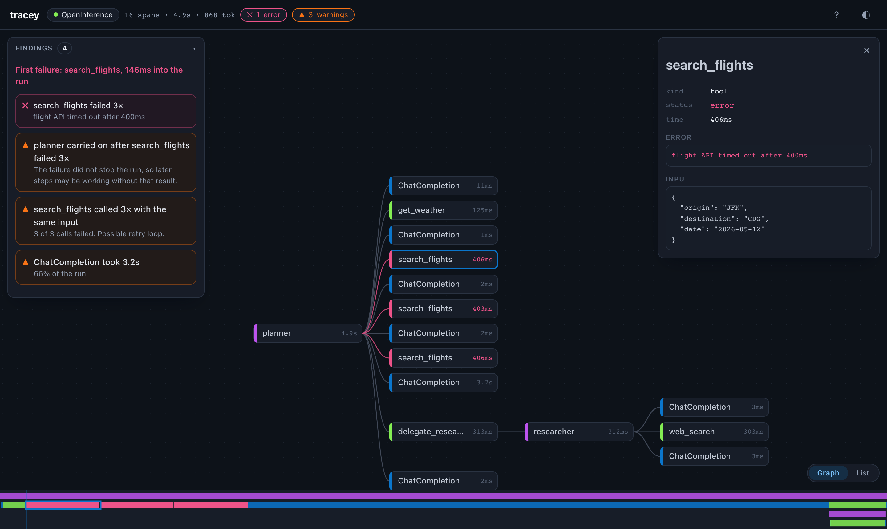

<h1 align="center">tracey</h1>

<p align="center"><b>Drop in an AI agent trace. See what it really did, and what went wrong.</b></p>

<p align="center">
  <picture>
    <source media="(prefers-color-scheme: light)" srcset="docs/images/hero-light.png">
    
  </picture>
</p>

An agent run is a long tree of model calls, tool calls, retries and sub-agents, each carrying big
blobs of prompt and output. Reading that as raw JSON or logs is slow, and the thing that went
wrong (a failed tool, a retry loop, a runaway step) is buried. tracey turns the file into a
picture and points at the problems.

In the screenshot above, `search_flights` timed out three times, the planner carried on without
the result, and one model call took two thirds of the run. tracey found all three on its own.

**Everything runs in your browser. Traces are never uploaded.**

## What you get

- **A call graph** you can pan and zoom, with every step as a card: kind, duration, errors.
- **Findings first.** Failed steps, failures the agent carried on past, the same call repeated,
  slow steps. Click one to jump to it; hover to outline every span involved.
- **A timeline strip** along the bottom that shows where the time went and where it broke.
- **An inspector** with a step's status, input, output and error, pretty-printed.
- **Source detection.** tracey works out where a file came from and says how sure it is.
- **Light, dark and auto themes**, and layouts that work from a phone to an ultrawide monitor.
- **Fast.** The graph is drawn on a 2D canvas with level-of-detail rendering; a 100,000-span
  trace parses in a fraction of a second in the perf spike ([numbers](docs/verification/perf-spike.md)).

## Try it

**Website:** <https://tracey.genguardx.ai> (drop a file, paste, or click *Try a sample*).
It is published with GitHub Pages from this repo (see [`.github/workflows/pages.yml`](.github/workflows/pages.yml)).

**Or run it locally** (Node 20+ and pnpm):

```bash
pnpm install
pnpm dev            # http://localhost:5173
```

Sample files to drop in are in [`fixtures/`](fixtures/). More in [docs/development.md](docs/development.md).

**In the terminal:**

```bash
pnpm tracey fixtures/openinference/travel-planner.collector-file.jsonl
```

```
✓ OpenInference (high confidence)
16 spans · 4.9s · 8 llm · 6 tool · 868 tokens

✕ search_flights failed 3×
  flight API timed out after 400ms
▲ planner carried on after search_flights failed 3×
▲ search_flights called 3× with the same input
▲ ChatCompletion took 3.2s  (66% of the run)
```

`tracey check <file>` exits non-zero when findings reach a severity, for CI.

## What it reads

| Source | Notes |
|---|---|
| OpenInference (Arize Phoenix, `openinference-instrumentation-*`) | OTLP JSON |
| OpenTelemetry GenAI (Strands, Dynatrace, Honeycomb, ...) | OTLP JSON |
| OpenLLMetry / Traceloop | OTLP JSON |
| Claude Code session transcripts | JSONL, sub-agents included |

Planned: Datadog LLM Observability, Langfuse, LangSmith, Codex, VS Code Copilot, Zed, HAR
captures. See the [roadmap](docs/roadmap.md).

**Don't have a trace file yet?** The [getting-started guides](docs/guides/README.md) show how to
get one from your tracing tool, from LangGraph / DeepAgents / Strands / OpenAI Agents / Claude
Agent SDK with no tracing set up, from a coding-agent harness, or from a third-party app.

## Packages

tracey is a set of small, separately usable packages under the `@ggx/` scope, plus apps built on them.

| Package | What it is |
|---|---|
| `@ggx/trace-model` | Compact, dependency-free span model (typed arrays) |
| `@ggx/trace-adapters` | Detect and read OTLP JSON and Claude Code transcripts |
| `@ggx/trace-insights` | The findings engine |
| `@ggx/trace-view-graph` | Pan-and-zoom call graph on a 2D canvas |
| `@ggx/trace-view-timeline` | Compact timeline strip |
| `@ggx/trace-theme` | GGX design tokens (dark, light, auto) |
| `apps/web` | The website |
| `apps/cli` | The terminal app |
| `apps/desktop` | Desktop app (Tauri, about 3 MB) |

Not published to npm yet.

## Tests

```bash
pnpm test           # unit tests
pnpm test:e2e       # browser tests (Chromium via Playwright)
pnpm typecheck
```

See [docs/testing.md](docs/testing.md) for what is covered and how to test by hand.

## Project docs

[Vision](docs/vision.md) · [Design](docs/design.md) · [UX principles](docs/ux-principles.md) ·
[Architecture](docs/architecture.md) · [Roadmap and next step](docs/roadmap.md) ·
[Decisions](docs/decisions.md) · [Competitive analysis](docs/competitive-analysis.md) ·
[Contributor and agent guide](AGENTS.md)

## Status

Early. The core packages, CLI, website and a macOS desktop build work; the VS Code extension, live
receiver (`tracey listen`), session picker and more sources are planned.

## License

Apache-2.0. See [LICENSE](LICENSE).
